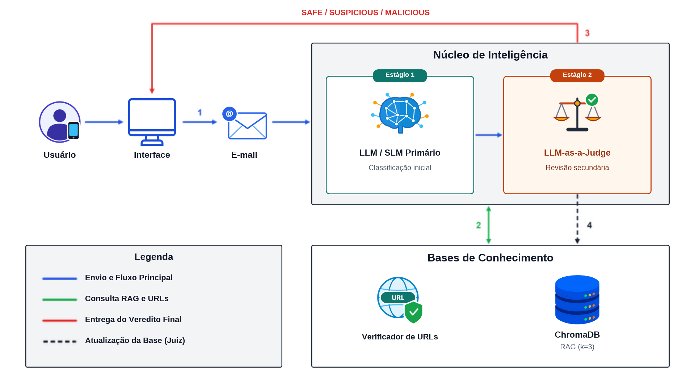

<div align="center">

# Judge-VerificAI

**Detecção de *Phishing* e Engenharia Social em dois estágios com RAG, verificação de URLs e revisão secundária via *LLM-as-a-Judge*.**

[](https://www.python.org/)
[](https://www.djangoproject.com/)
[](https://www.langchain.com/)
[](https://www.trychroma.com/)
[](https://ollama.com/)

**Prompts completos dos estágios 1 e 2 para revisores:** [**`PROMPTS.md`**](PROMPTS.md)

</div>

---

## Visão Geral

O **Judge-VerificAI** é uma arquitetura em dois estágios desenvolvida no **LARCES** (Laboratório de Redes de Computadores e Segurança) da **Universidade Estadual do Ceará (UECE)** para apoiar a detecção de *phishing*, *spam* e engenharia social em mensagens de **e-mail** e **SMS**.

O pipeline integra:
1. **Pré-processamento determinístico (Regex):** remoção de marcações HTML/formatação, sanitização de dados sensíveis (PII — CPF, CNPJ, telefone, cartão, e-mail, PIX, RG, CEP e dados bancários) e extração de URLs.
2. **Bases de Conhecimento:** verificação externa de reputação de URLs (interface modular instanciada nos experimentos com *Google Safe Browsing*) e busca de similaridade no **ChromaDB** ($k=3$ exemplos históricos com *embeddings* `BAAI/bge-small-en-v1.5`).
3. **Estágio 1 (Classificação Primária):** inferência por LLM em nuvem ou SLM local quantizado retornando `SAFE`, `SUSPICIOUS` ou `MALICIOUS` em JSON estruturado com justificativa didática.
4. **Estágio 2 (*LLM-as-a-Judge*):** revisão secundária automatizada (`CONFIRMED` ou `CORRECTED`) sem feedback humano, avaliada nos experimentos com `DeepSeek-v4 Flash`.

> **Atenção aos revisores:** todos os prompts utilizados no Estágio 1 (operacional e benchmark) e no Estágio 2 (*Arbiter* / Juiz), bem como as regras de mapeamento tri-estado e normalização determinística, estão documentados na íntegra em [`PROMPTS.md`](PROMPTS.md).

---

## Arquitetura

<div align="center">



</div>

---

## Principais Resultados dos Benchmarks (13.472 mensagens)

Os experimentos avaliaram **5.472** mensagens do *SMS Spam Collection* e **8.000** do *Enron Spam Dataset* (10 modelos isolados e 9 configurações com auditoria secundária pelo Juiz `DeepSeek-v4 Flash`):

| Configuração (Primário + Juiz) | SMS Acur. (%) | SMS Prec. (%) | SMS Rev. (%) | SMS F1 (%) | E-mail Acur. (%) | E-mail Prec. (%) | E-mail Rev. (%) | E-mail F1 (%) |
|---|---:|---:|---:|---:|---:|---:|---:|---:|
| **DeepSeek-v4 Flash (isolado)** | 96,66 | 82,47 | 95,37 | 88,45 | 91,30 | 89,47 | 88,27 | 88,86 |
| **GLM 5.1 + Juiz** | **97,44** | **89,61** | **91,56** | **90,58** | **93,00** | 98,61 | **83,37** | **90,35** |
| **MiniMax-m2.7 + Juiz** | 97,20 | 88,39 | 91,16 | 89,75 | 91,79 | 98,52 | 80,32 | 88,50 |
| **Qwen 3.5 (nuvem) + Juiz** | 96,98 | 87,09 | 91,01 | 89,01 | 92,16 | 97,30 | 82,36 | 89,21 |
| **GPT-Oss + Juiz** | 96,98 | 87,70 | 90,20 | 88,93 | 90,27 | 98,64 | 76,31 | 86,05 |
| **Ministral 3 (14B) + Juiz** | 97,04 | 88,05 | 90,20 | 89,11 | 90,84 | 98,20 | 78,13 | 87,02 |
| **Gemma-4-12B + Juiz** | 96,93 | 87,45 | 90,07 | 88,74 | 91,76 | **98,66** | 80,17 | 88,46 |
| **Qwen 3.5 (9B) + Juiz** | 96,78 | 86,63 | 89,93 | 88,25 | 90,77 | 97,29 | 78,73 | 87,03 |
| **Mellum2-12B + Juiz** | 96,88 | 89,28 | 87,21 | 88,23 | 89,75 | 98,30 | 75,24 | 85,24 |
| **Llama 3 (8B) + Juiz** | 96,77 | 87,80 | 88,16 | 87,98 | 90,18 | 97,24 | 77,21 | 86,07 |

Os relatórios brutos e tabelas consolidadas estão em `metricas_novas/` (modelos isolados) e `metricas_judge/` (modelos com Juiz e verificadores de URL).

---

## Como Rodar o Projeto

### Pré-requisitos
- **Python 3.11+** e **Git**
- **Ollama** instalado localmente (para rodar SLMs locais) e/ou chave **Ollama Cloud**
- Chaves de API conforme o modo desejado (`.env`):
  - `SECRET_KEY` (obrigatória para o servidor Django)
  - `OLLAMA_API_KEY` / `OLLAMA_MODEL` (inferência primária e estágio Juiz)
  - `SAFE_BROWSING_API_KEY` (verificação de reputação de URLs via *Google Safe Browsing*)
  - `GEMINI_API_KEY` (opcional — fallback em nuvem / estudo de caso)

---

### 1. Clonar e configurar o ambiente

```bash
git clone https://github.com/LarcesUece/sbrc_judge_verificai.git
cd sbrc_judge_verificai
```

Crie e ative o ambiente virtual e instale as dependências:

**Windows (PowerShell):**
```powershell
python -m venv venv
.\venv\Scripts\Activate.ps1
pip install -r requirements.txt
```

**Linux / macOS:**
```bash
python3 -m venv venv
source venv/bin/activate
pip install -r requirements.txt
```

Copie o arquivo de exemplo e preencha suas chaves:
```bash
cp .env.example .env
```

---

### 2. Executar a API Web (Django REST + Swagger)

> **Opcional (RAG):** caso deseje popular previamente a memória vetorial `chroma_db/` com os arquivos públicos `database/email_dataset.csv` e `database/sms_dataset.csv`, execute `python scripts/build_vector_db.py` antes de iniciar o servidor. Caso contrário, a aplicação inicia normalmente e registra exemplos novos conforme uso.

```bash
python manage.py migrate
python manage.py runserver
```

Após subir o servidor:
- **Documentação interativa (Swagger):** `http://127.0.0.1:8000/swagger/`
- **Health check:** `http://127.0.0.1:8000/health/`
- **Painel administrativo:** `http://127.0.0.1:8000/admin/`

**Exemplo de requisição para analisar uma mensagem:**
```bash
curl -X POST http://127.0.0.1:8000/api/analisar/ \
  -H "Content-Type: application/json" \
  -d '{
    "texto": "AVISO URGENTE: sua conta universitária será bloqueada hoje. Acesse http://exemplo-teste.com para confirmar sua senha.",
    "remetente": "teste@exemplo.com"
  }'
```

---

### 3. Executar o Bot de E-mail (Gmail API)

1. Coloque suas credenciais OAuth 2.0 da Google Cloud (`credentials.json`) na raiz do projeto (não versionado por segurança).
2. Gere os tokens locais executando:
   ```bash
   python scripts/autorizar_gmail.py
   ```
3. Inicie o monitoramento contínuo (polling agendado):
   ```bash
   python email_bot.py
   ```

---

### 4. Executar via Docker

```bash
docker build -t judge-verificai .
docker run --env-file .env -p 7860:7860 judge-verificai
```

---

### 5. Reproduzir os Benchmarks do Artigo (`evaluate/`)

Os conjuntos de dados públicos não são redistribuídos diretamente no repositório para manter o histórico enxuto. Para reproduzir os experimentos:

1. Baixe os datasets públicos e salve-os na pasta `database/`:
   - *SMS Spam Collection* (UCI) → `database/sms_dataset.csv` (colunas `Message`, `Label`)
   - *Enron Spam Dataset* (Kaggle) → `database/email_dataset.csv` (colunas `Email Text`, `Email Type`)
2. Garanta o arquivo `.env` configurado com `OLLAMA_API_KEY` (e `SAFE_BROWSING_API_KEY`).
3. Ajuste no início do script desejado o modelo primário (`MODELO_OLLAMA`) e o modelo Juiz (`MODELO_JUDGE`, ex.: `deepseek-v4-flash:cloud`) e execute:

- **Modelos em nuvem + Juiz:**
  ```bash
  python evaluate/evaluate_ollama_cloud.py
  ```
- **Modelos locais quantizados (requer Ollama local ativo, ex.: `ollama pull llama3:8b`) + Juiz:**
  ```bash
  python evaluate/evaluate_ollama.py
  ```
- **Verificadores externos de URL (opcional, requer `database/balanced_urls.csv`):**
  ```bash
  python evaluate/evaluate_url_verifiers.py
  ```

Os scripts criam automaticamente uma coleção vetorial isolada (`chroma_db_evaluate*`) populada com 100 amostras externas de cada dataset fora da janela de avaliação (conforme protocolo descrito no artigo) e salvam os relatórios em `metricas_judge/`.

---

## Estrutura do Repositório

```text
sbrc_judge_verificai/
├── PROMPTS.md                 # Prompts completos (Estágio 1, Estágio 2 e normalização)
├── README.md                  # Documentação e guia de execução
├── requirements.txt           # Dependências Python
├── .env.example               # Modelo de variáveis de ambiente
├── Dockerfile / start.sh      # Empacotamento e inicialização em contêiner
├── manage.py                  # Ponto de entrada Django
├── email_bot.py               # Monitoramento automatizado via Gmail API
│
├── spamapi/                   # Configurações Django, rotas principais e Swagger
├── detector/                  # Núcleo da aplicação (sanitização Regex, RAG, URL check, API)
├── scripts/                   # Utilitários (build_vector_db.py, autorizar_gmail.py, teste_rag.py)
├── evaluate/                  # Scripts dos benchmarks (local, nuvem, API e URLs)
├── metricas_novas/            # Relatórios e CSVs dos 10 modelos isolados (sem Juiz)
├── metricas_judge/            # Relatórios e CSVs das 9 configurações auditadas (com Juiz)
└── Figures/                   # Diagrama de arquitetura em português (fig1_pt.png)
```

---

## Autores e Agradecimentos

- **Autores:** Pedro M. M. de Sousa, João V. dos Santos, Francisco V. J. Nobre, Alex F. R. Trajano e Rafael L. Gomes
- **Instituições:** Departamento de Computação — Universidade Estadual do Ceará (LARCES/UECE) e Instituto Atlântico
- **Fomento:** Pesquisa parcialmente financiada pelo **CNPq** (Processos 305946/2025-0 e 405940/2022-0) e pela **CAPES** (Códigos 88887.954253/2024-00 e 88887.972043/2024-00).
